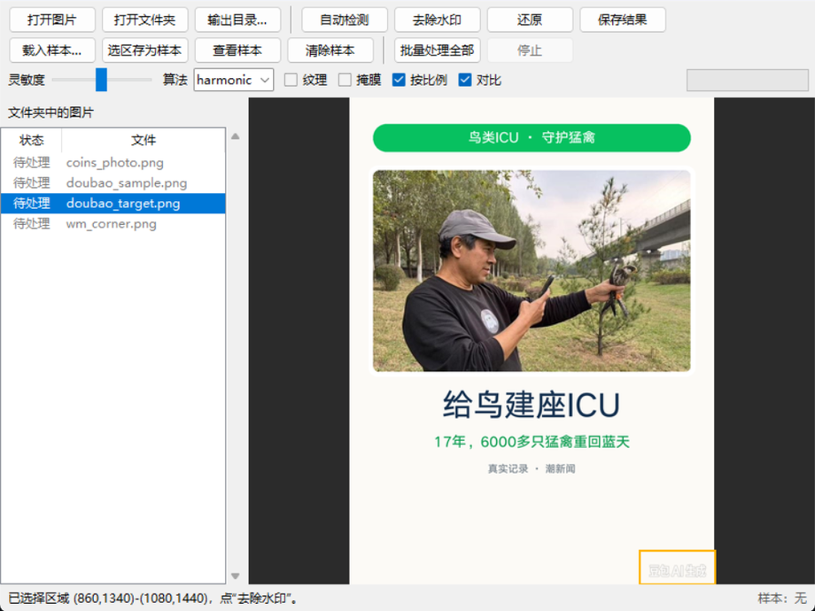
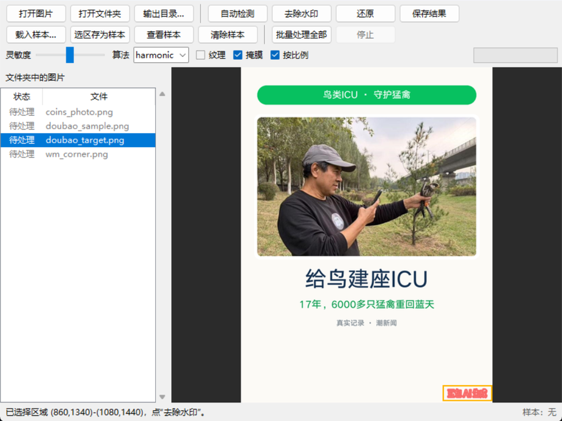
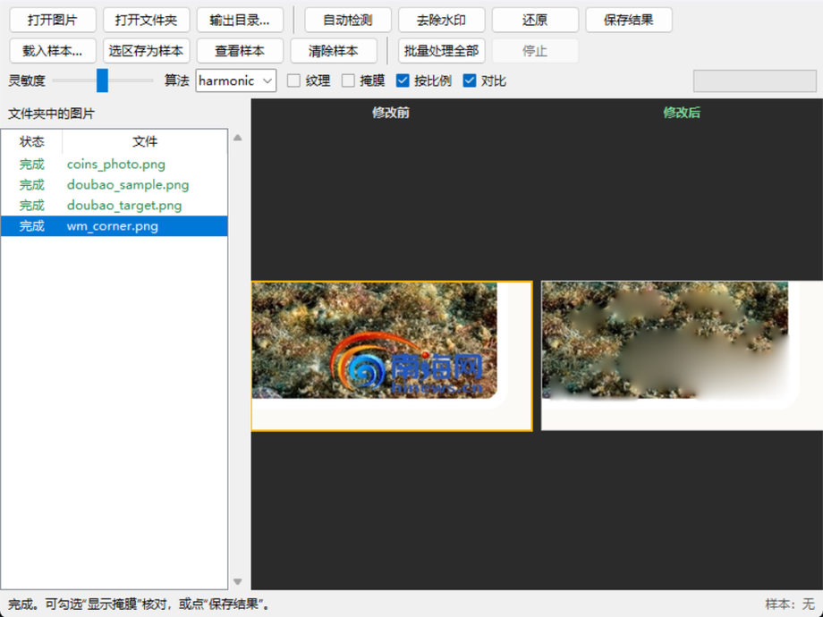
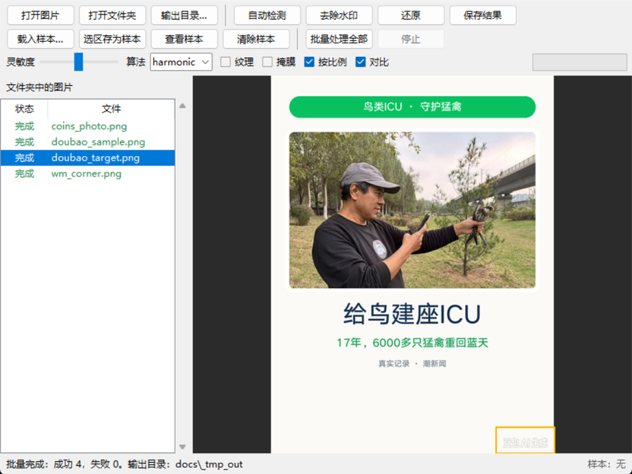

# wm —— 图片水印分析 / 去除工具

纯 **Python + numpy + Pillow** 实现的水印分析与去除工具，**不依赖 OpenCV**，
也提供 tkinter 图形界面。装好依赖（见第零节）即可运行，Windows / macOS / Linux 通用。

它做两件事：

1. **分析**：估计“干净背景”，反解出水印的**叠加色**与**透明度**，生成像素级掩膜，
   并给出水印候选区域、覆盖率、平均 alpha 等指标。
2. **去除**：用调和（Laplace）扩散或多尺度 Telea 修复掩膜区域，可选地再把邻近
   区域的纹理细节补回去。

```
images/photo_bird.jpg  ──分析──▶  叠加色 #F8F8E8 α≈0.83 / #1878B8 α≈0.89
                                     ▼
                              像素掩膜（文字 + 线框）
                                     ▼
out/photo_clean.png    ◀──修复──  调和扩散（无接缝）
```

---

## 零、安装与运行环境

### 需要什么

| 项目 | 要求 |
| --- | --- |
| Python | **3.9 及以上**（开发与实测：3.12） |
| 第三方库 | 只有 `numpy` 和 `Pillow`（不需要 OpenCV、不需要 GPU、不需要联网） |
| 图形界面 | `tkinter`，Python 官方安装包自带；Linux 用系统 Python 时可能需要 `sudo apt install python3-tk` |
| 系统 | Windows / macOS / Linux 都行（Windows 下中文输出见文末「常见问题」） |

### 安装

```bash
git clone git@github.com:SinWrong/picture_processing_tool.git
cd picture_processing_tool

python -m pip install -r requirements.txt       # 等价于 pip install numpy pillow
```

> 用 conda 也可以：`conda create -n wm python=3.12 numpy pillow -y && conda activate wm`。

### 验证安装

```bash
python wm.py --help          # 应列出 analyze / remove / batch / sample / match / gui
python tests/test_basic.py   # 自检脚本，最后一行应显示 "38 passed, 0 failed"
```

### 三步上手（最常用）

```bash
python wm.py gui             # 打开图形界面
```

1. 点「**打开文件夹**」，选中要处理的图片所在目录（jpg / png / webp / bmp / tif）；
2. 在左侧列表点一张图，右边预览里**按住鼠标拖一个框**，把水印整个圈住；
3. 勾上「**批量按比例套用选区**」，点「**批量处理全部**」。

结果写在 `<原文件夹>\out\` 下，文件名是 `<原名>_clean.png`，**原图不会被改动**。

---

## 一、快速开始

> 下面的 `python` 指**装了 numpy/Pillow 的那个解释器**。用 conda 环境时换成
> `conda run -n wm python` 或该环境的完整路径（例如 `D:\anaconda3\envs\new_env\python.exe`）。

```powershell
# 1) 看环境是否就绪（项目根目录执行）
python wm.py --help

# 2) 只分析，不修改图片：打印候选区域 + 叠加色 + 透明度，导出 JSON / 调试图
python wm.py analyze images\photo_bird.jpg `
    --json out\report.json --debug out\mask_overlay.png

# 3) 指定区域去除水印（最推荐：快、准）
python wm.py remove images\photo_bird.jpg `
    -o out\photo_clean.png --region 470,375,170,105

# 3.5) 顺便导出“修改前 / 修改后”对比图
python wm.py remove images\photo_bird.jpg -o out\photo_clean.png `
    --region 470,375,170,105 --compare out\photo_compare.png

# 4) 自动检测 + 去除
python wm.py remove images\poster_icu.png `
    -o out\poster_clean.png --auto

# 5) 批量处理一个目录
python wm.py batch images -o out --region 470,375,170,105

# 6) 图形界面：可以直接打开一个文件夹，列表里逐张预览、框选、批量处理
python wm.py gui
python wm.py gui D:\照片\待处理     # 启动即载入该文件夹

# 7) 先截一个“水印样本”，之后靠它自动定位（详见第四节）
python wm.py sample images\poster_icu.png `
    -o samples\doubao_watermark.npz --region 860,1340,220,100
python wm.py remove "D:\照片\a.jpg" `
    -o out\a_clean.png --sample samples\doubao_watermark.npz
```

> Windows 下建议先 `chcp 65001`，或在 PowerShell 里设置 `$env:PYTHONIOENCODING="utf-8"`，
> 中文输出才不会乱码。

---

## 二、图形界面（最常用，照着点就行）

窗口默认 **800×600**（可拉伸，最小 720×520）。左边是文件列表，中间是预览画布，上面三行
工具栏，最下面是状态栏。



### 启动

```bash
python wm.py gui
```

Windows 上也可以直接**双击项目目录里的 `启动界面.bat`**（等价于上面的命令，出错时会停住
显示原因）。

### 界面分四块

| 区域 | 内容 |
| --- | --- |
| 顶部工具栏 | 三行：文件操作 / 处理操作 / 参数（灵敏度、算法、纹理、掩膜、按比例） |
| 左侧列表 | 「状态 + 文件名」；状态有 待处理 / 处理中… / 完成（绿色）/ 失败（红色） |
| 中间画布 | 图片预览；**按住鼠标拖拽 = 框选水印区域** |
| 底部状态栏 | 操作提示；右下角显示当前是否载入了样本 |

### 按钮速查

**第一行：文件与单张处理**

| 按钮 | 作用 |
| --- | --- |
| 打开图片 | 只处理一张图 |
| 打开文件夹 | 列出该目录下所有图片（jpg/png/webp/bmp/tif），输出目录默认 `<该目录>\out` |
| 输出目录… | 改批量输出的位置 |
| 自动检测 | 让程序自己猜水印在哪，画布上出现虚线框；猜得不准就再用鼠标框一次 |
| 去除水印 | 按当前框选（或自动检测/样本）去水印，结果显示在画布上 |
| 还原 | 回到原图；只要没点「保存结果」，磁盘上的原图不会被改动 |
| 保存结果 | 把画布上的结果另存为文件 |

**第二行：水印样本与批量**

| 按钮 | 作用 |
| --- | --- |
| 载入样本… | 载入 `.npz` 样本或一张水印小图，之后自动按样本找水印（见第五节） |
| 选区存为样本 | 把当前框选的区域存成样本，同款水印可以反复用 |
| 查看样本 | 弹窗看样本最终形状（棋盘格 = 透明区），确认截对了 |
| 清除样本 | 卸载样本，回到「框选 / 自动检测」的逻辑 |
| 批量处理全部 | 对列表里的所有图批量处理 |
| 停止 | 中途停止批量（已处理完的不会丢） |

**第三行：参数**

| 控件 | 作用 |
| --- | --- |
| 灵敏度 | 往右更敏感：淡的水印也能抓到，但更容易误伤背景纹理 |
| 算法 | `harmonic`（默认，无接缝）/ `telea` / `fast` |
| 纹理 | 给修复区补纹理，草地、树叶这类背景更自然 |
| 掩膜 | 勾上后画布用**红色**显示“要擦掉的像素” |
| 按比例 | 批量时把当前选区按百分比套到每张图（尺寸不同也能用）；不勾则按固定像素坐标 |
| 对比 | 处理后画布**左右并排**显示「修改前 / 修改后」（默认勾选）；取消就只显示结果 |

### 处理一张图：四步

1. **打开**：点「打开图片」（或「打开文件夹」后在左边点一行）；
2. **框选**：在画布上按住鼠标拖一个框，把水印整个圈住。框歪了重新拖即可；
   懒得画就点「自动检测」，再微调；
3. **核对**（推荐）：勾上「掩膜」——红色盖住水印，说明框对了；盖到别处就重新框。

   

4. **去除**：点「去除水印」，画布换成结果；满意就点「保存结果」。

   

### 前后对比：一眼看效果

点完「去除水印」，画布默认就切成**左右两半**：

- 左半边标题「**修改前**」，右半边标题「**修改后**」，两边缩放一致、竖直对齐，方便逐处比对；
- 参数行里的「**对比**」开关（默认勾选）可以随时切换：取消勾选 = 只看结果大图，再勾上 = 回到并排；
- 此时勾「掩膜」，右半边显示的是"结果 + 红色掩膜"，能看出到底擦掉了哪些像素；
- 对比状态下**框选依然作用于左半边（原图）**，重新拖框后点「去除水印」即可重来；
- 对比只是**查看方式**，不会改变保存的文件——「保存结果」存的是干净的那张图。

   

### 批量处理：三步

1. 「打开文件夹」选中一批图（列表里会出现该目录的所有图片）；
2. 点列表里任意一张，**框住水印**，并勾上「按比例」；
3. 点「批量处理全部」——左侧每行从「待处理」变成绿色的「完成」，底部显示成功/失败数量。

   

- 结果默认写到 `<原文件夹>\out\`，命名为 `<原名>_clean.png`；想换位置点「输出目录…」；
- 批量进行中可以「停止」，已完成的图保留；
- **没有框选**就直接批量时，会逐张自动检测（见第三节的「同批统一」）；
- 在列表里**双击某一行** = 只处理这一张。

### 图形界面的几个小贴士

- 框要**贴着水印画**：太大容易被旁边内容干扰，太小会漏掉边缘；框切掉水印一角时程序会自动
  朝那一侧补一点；
- **想看前后差别**：保持「对比」勾选，画布就是左右并排；命令行的 `--compare` 也能导出对比图；
- 结果不满意：点「还原」重来，或微调「灵敏度」再点一次「去除水印」；
- 「保存结果」默认存 png，**原图始终不被修改**；
- 一批图里有少数没处理干净时，单独把这几张重跑一遍（换框或换样本）通常比整批重来更快。

---

## 三、批量处理：为什么会更稳

批量（CLI `wm.py batch` 和界面「批量处理全部」）现在会做**同批统一**：

1. 先逐张检测、逐张处理；
2. 把同尺寸的图分组，取“多数图命中的区域”作为这批的统一区域；
3. 个别检测跑偏的图，用这个统一区域重跑一遍（日志里会标「按同批多数区域」）。

因为同一批图的水印位置和样式通常一致，这比逐张各猜各的稳定得多。

不过最稳的仍然是**框选一次 + 勾「按比例」**：框选走的是“框外一圈当背景”的判据，
在砂石、路面、珊瑚这类纹理背景上，比自动检测“猜叠加色”可靠得多。

---

## 四、区域怎么写

`--region` 支持两种写法：

| 写法 | 例子 | 说明 |
| --- | --- | --- |
| 像素 | `470,375,170,105` | x, y, 宽, 高 |
| 百分比 | `73%,78%,27%,22%` | 相对图片宽高的 x, y, 宽, 高 |

**手工框选时，程序用“框外一圈”当背景模型**：先取框外一圈像素聚类出背景颜色，
再在框内找“不像这些颜色”的像素。这样即使背景很花（海水、珊瑚、树叶），也不会把背景
本身当成水印——这正是之前彩色 logo 去不掉的原因（旧逻辑按“最像叠加色的颜色”猜，花色
背景会把前几名占满）。

水印被框切掉一角时（掩膜顶到框边），会**只朝被顶住的那一侧**小幅外扩（每轮 12%，最多
40px、最多两轮）再重算。框要贴着水印画，但不用卡得特别死。

---

## 五、水印样本：截一次，到处套用

同一个站 / App 的水印会出现在很多张图里，位置、大小、底图都不一样。这时不用逐张画框：
**从任意一张图里截一个样本，之后靠样本自动定位**。

```powershell
# 1) 截样本（区域写法同 --region）
python wm.py sample images\poster_icu.png `
    -o samples\doubao_watermark.npz --region 860,1340,220,100

# 2) 先看它会落在哪（不改图；--debug 画出匹配框）
python wm.py match "D:\照片\a.jpg" `
    --sample samples\doubao_watermark.npz --debug out\match.png

# 3) 定位 + 去除
python wm.py remove "D:\照片\a.jpg" `
    -o out\a_clean.png --sample samples\doubao_watermark.npz

# 4) 整个目录用同一套样本批量处理
python wm.py batch "D:\照片" -o out `
    --sample samples\doubao_watermark.npz
```

图形界面里对应四个按钮：

| 按钮 | 作用 |
| --- | --- |
| **载入样本…** | 选一个 `.npz` 或一张水印图片作为样本（只在内存里，不改文件） |
| **选区存为样本** | 把画布上当前框选的区域存成 `.npz` 样本 |
| **查看样本** | 弹窗看样本最终长什么样（棋盘格 = 透明区） |
| **清除样本** | **卸载**当前样本，只清内存、不删磁盘文件；之后「去除水印/批量处理」回到“选区或自动检测”的逻辑 |

载入样本后，「去除水印」和「批量处理全部」都会先按样本定位再处理，不需要再画框。

「载入样本…」的文件框里可以选两种东西：

- **`.npz` 样本**：用 `wm.py sample` 或「选区存为样本」生成的；
- **一张图片**（png/jpg/…）：适合手工裁好的水印小图；
  * **真的有透明区**的 PNG → 直接把 alpha 当水印形状；
  * **白底（或彩底）水印图**、alpha 全不透明 → 当成「水印 + 背景」现场反解，
    再自动裁到文字范围（比如 `豆包AI生成.png`：203×77 整张进去，实际样本是 168×39 的文字）；
  * 如果选的是整张截图，程序会自动打开它，并提示你「框选水印 → 选区存为样本」。

> 实测：用 `豆包AI生成.png`（白底、alpha 全 255）当样本，在海报里定位到
> `(888,1381)-(1056,1420)`、置信度 0.77，擦除后原位置只剩背景。

### 原理：样本就是水印

样本里存的不是截图，而是水印本身的 **alpha 图**（笔画/色块形状）+ 叠加色：

1. 用样本的叠加色在目标图上反解 alpha（`I = a·C + (1-a)·B`），得到“哪里像水印”；
2. 拿样本 alpha 做**带掩膜的归一化互相关**，在 0.5~1.6 倍之间多尺度扫描找到位置和缩放；
3. 用“局部 alpha 强度”和整体明暗补偿（`bg_luma`）压掉弱匹配；
4. **擦除时按样本形状来**：把样本 alpha 按找到的位置/缩放原样铺上去，就是掩膜；
   再在边缘 5px 内用目标图自己的叠加信息补一下抗锯齿 —— 不会把旁边的草/别的内容也擦掉。

两种模式（`--sample-mode` / 代码里的 `mode`）：

- `stamp`（默认）：样本形状即水印，直接按它擦；
- `region`：在匹配位置重新做一次叠加层分析（样本不太干净、或水印在目标图里明显变形时更保险）。

所以换底图、轻微曝光差异、JPEG 压缩、平移缩放都能找到；水印本身被调得看不见了，
自然也就找不到（这是预期的，因为没什么可去）。

### 几个建议

- 样本要截**完整**水印（别把字切一半），带一点边距没关系，程序会自动裁到笔画范围；
- 图形界面里点「**查看样本**」能看到最终被当成水印的形状（棋盘格表示透明部分），
  确认它是不是你想要的那块；擦除效果不对时可以先换 `region` 模式试试；
- 找不到时先把 `--min-score` 从 `0.5` 调到 `0.35` 试试，误配多就往上调；
- 一张图里重复出现多次（满屏水印）时，`--max-matches` 控制最多处理几处（默认 4）；
- 匹配比“画框”慢一些（1080p 约 2~4 秒/张），批量时进度条会逐张更新。

---

## 六、自动检测是怎么挑区域的

自动检测（不给 `--region` 时）会在画面四角/四边摆一批窗口，各自跑一遍叠加层分析，
再按“像不像水印”重新排序。排序用的判据：

1. **一行高度一致的字**：水印文字的字高方差很小、基线平、横向铺开；
   泡沫、树叶、硬币反光这类纹理的连通块高度杂乱，会被压分（×0.5）。
2. **墨迹位置**：用掩膜里“墨迹”的中心判断靠角程度，而不是窗口中心——
   窗口常为了贴边被拉得很长，用窗口中心会误判成“在画面中间”。
3. **右下角优先**：多数 App/站点的水印在右下角，这一侧会额外加分。
4. **贴边数量**：同时贴两条边（角落）比只贴一条边更像水印。

找到候选之后还会再修两轮：

- **收拢**：第一轮掩膜往往只抓到最明显的部分，把区域缩到掩膜附近再分析一次，
  颜色统计更聚焦，淡色/细笔画能补回来；
- **外扩**：如果掩膜顶到了区域边界（水印被框切掉一角），只朝被顶住的那一侧外扩再分析；
- **补孔**：去除前把掩膜内部的小孔（字腔、细缝）补上，避免修复后留下残留小点。

实测（`tests/data/coins_photo.png`，深色唱片 + 右下角浅色文字）：首选得分 2.78，
次选 1.03，区域 `(554,477)-(692,596)`，正是右下角那行字。

---

## 七、参数说明

| 参数 | 默认 | 作用 |
| --- | --- | --- |
| `--region` | 无 | 水印区域，见上表；不给则走自动检测 |
| `--sensitivity` | `0.5` | 分析灵敏度 `0~1`。调高会把更淡的笔画算进来，但更容易误伤背景纹理 |
| `--method` | `harmonic` | `harmonic` = 多尺度 Laplace（无方向性接缝，推荐）；`telea` = 快速行进法；`fast` = 小窗口 Telea（最快） |
| `--texture` | 关 | 叠加纹理细化，草地/树叶等高频背景观感更自然（可能引入轻微伪影） |
| `--mask` | 无 | 同时导出掩膜 PNG（白 = 待修复） |
| `--debug` | 无 | 同时导出“掩膜叠加在原图上”的调试图 |
| `--compare` | 无 | 同时导出“修改前 / 修改后”左右并排的对比图 |
| `--json` | 无 | 把完整报告写成 JSON |
| `--no-auto` | 关 | 禁止自动检测，必须给 `--region` |
| `--sample` | 无 | 水印样本 `.npz`（也接受一张水印小图）；给了就按样本定位（忽略 `--region`/自动检测） |
| `--min-score` | `0.5` | 样本匹配的最低置信度 `0~1` |
| `--max-matches` | `4` | 一张图里最多处理几处匹配 |
| `--sample-mode` | `stamp` | `stamp` = 按样本形状直接擦；`region` = 在匹配处重新分析叠加层 |

---

## 八、输出与报告

`remove` 会写出处理后的图片；`--json` 里包含：

```jsonc
{
  "image":      { "path": "...", "width": 640, "height": 480, "has_alpha": false },
  "region":     [470, 375, 640, 480],           // 实际分析区域 (x0,y0,x1,y1)
  "candidates": [ { "bbox": [...], "score": 1.43, "overlays": [...] } ],
  "mask": {
    "mask_pixels": 9742,
    "coverage_in_region": 0.39,
    "overlays": [ { "color": "#1878B8", "name": "mode",
                    "coverage": 0.038, "opacity": 0.95, "mean_alpha": 0.89 } ]
  },
  "removal": { "mask_pixels": 9742, "mask_ratio": 0.031, "bbox": [...] }
}
```

- `overlays[].color`：反解出的水印**叠加色**（水印“原色”，不是混合后的颜色）
- `overlays[].mean_alpha`：该颜色在水印像素上的平均不透明度（>0.85 基本不透明）
- `score`：候选区域“像水印”的置信度（文字行排布、细结构、靠角程度综合）

另外几个可选输出（都不影响结果图本身）：

| 参数 | 输出 |
| --- | --- |
| `--mask` | 掩膜 PNG（白 = 要修复的像素） |
| `--debug` | 掩膜叠加在原图上的调试图 |
| `--compare` | **修改前 / 修改后** 左右并排的对比图（界面里是默认的对比视图） |

---

## 九、原理

### 1. 背景估计

对每个通道做**中值滤波**（默认窗口 31，先镜像填充避免边缘污染）。窗口比水印笔画粗，
所以水印会被“滤掉”，留下干净背景 `B`；`|I - B|` 就是残差。

### 2. 叠加层颜色（color modes）

水印通常是**少数几个固定颜色**（白字、品牌色线框、灰字）。把 ROI 的颜色量化到 16 级
直方图，取出现次数最多的若干颜色作为候选叠加色 `C`，并剔除与**背景主色调**
（背景图自身的颜色众数）过近的颜色。

### 3. 透明度反解（alpha matte）

假设水印是线性混合：

```
I = a·C + (1 - a)·B        →     a = (I - B) / (C - B)
```

逐通道求 `a`：真实的水印像素三个通道解出的 `a` 应当**一致**（`spread` 小），
自然纹理则不会。再叠加两条判据：

- **相对纹理偏离** `|I-B| / (局部纹理 + 6)`：必须明显强于背景自身的起伏；
- **滞后阈值**：只保留包含“强 alpha 核心”的连通块（去掉零散噪点）。

### 4. 修复（inpainting）

- `harmonic`：把掩膜区域当作未知量，**多尺度求解 Laplace 方程**（粗层 Jacobi 收敛 →
  逐层上采样 → 细层迭代）。优点是不会有 Telea 那种“四边推进”造成的 X 形色带。
- `telea`：快速行进法（FMM），按距离场由外向内推进，适合细笔画。
  梯度项只在贴边 2~3 像素内启用，避免大洞内部发散。

### 5. 纹理细化（可选 `--texture`）

扩散修复会把纹理糊平。纹理细化取原图的高频分量 `I - blur(I)`，按“低频最相似”
在附近找一块**无掩膜**的区域做供体，把它的高频补贴到修复结果上，并在掩膜边界羽化。

---

## 十、效果与局限（重要）
| 场景 | 效果 |
| --- | --- |
| 纯色/渐变背景上的文字水印、角标、线框（如示例海报） | 很好，基本看不出痕迹 |
| 半透明白字压在**纹理背景**（草地、树叶）上 | 水印能去掉，但修复区会变平滑，放大可见“糊块” |
| 大面积不透明贴图 / 严重压缩的 JPEG | 只能做到“看不见内容”，不保证看不出修补 |

这是**经典图像修复**的固有限制：扩散类算法不会“无中生有”造纹理。需要完全无痕的
纹理背景，建议接入深度学习修复模型（LaMa / MAT 等）——本工具的掩膜生成部分是通用的，
可以直接把 `mask` 喂给这类模型。

另外：**自动检测是启发式的**。对截图、海报、字幕条这类“干净背景 + 固定颜色文字”非常准；
对自然照片（比如树林里也有大片白色高光）可能挑错候选。所以推荐的工作流是
**用 GUI 或 `--region` 指定区域**，`analyze` 只用来辅助判断。

### 性能

纯 numpy/Pillow，单线程（Python 3.12 / numpy 2.x 实测）：

| 图片 | 分析（背景 + 掩膜） | 修复 | 合计 |
| --- | --- | --- | --- |
| 640×480 | ≈ 0.5 s | ≈ 0.6 s | ≈ 1 s |
| 1080×1440 | ≈ 0.9 s（自动检测再加 ≈ 1 s） | ≈ 1.5~2.8 s | ≈ 2.5~5 s |

背景估计先把图缩到一半再做中值滤波（窗口同步缩放，等效窗口仍约 31px），
比全分辨率快一个数量级，掩膜几乎不变。

---

## 十一、目录结构

```
wm.py                 命令行入口（analyze / remove / batch / sample / match / gui）
requirements.txt      运行依赖（numpy + Pillow）
启动界面.bat          Windows 下双击启动图形界面
README.md             本说明
docs/                 界面截图（README 里引用）
wmkit/
  analysis.py         背景估计、颜色众数、alpha 反解、掩膜、候选区域检测
  inpaint.py          Telea（FMM）修复
  fill.py             多尺度 Laplace 调和修复
  texture.py          纹理细节转移
  pipeline.py         端到端流程 + 区域参数解析 + 报告
  template.py         水印样本：截取 / 存取 / 多尺度模板匹配 / 定位后生成掩膜
  gui.py              tkinter 图形界面（单张 + 文件夹批量 + 样本）
  imageio.py          读写与可视化
  morph.py            形态学 / 连通域 / 积分图
scripts/make_demo.py          重新生成 out/ 里的示例输出与对比图
scripts/make_sample_demo.py   样本匹配示例（换尺寸/亮度后仍能定位并去除）
scripts/make_coins_demo.py    自动检测示例（深色纹理背景 + 右下角文字）
scripts/make_doubao_demo.py   白底水印图当样本的示例
scripts/make_batch_compare.py 批量结果对比图（原图 / 旧 / 新）
samples/              示例水印样本（doubao_watermark.npz）
tests/data/           回归测试用的小图（自动检测 / 彩色 logo / 豆包样本）
images/               示例原图
out/                  生成物（结果、掩膜、对比图、JSON 报告），已在 .gitignore 里
tests/test_basic.py   冒烟测试
```

跑测试 / 重新生成示例：

```powershell
python tests\test_basic.py
python scripts\make_demo.py
```

---

## 十二、作为库调用

```python
from wmkit import imageio, pipeline

rgb, alpha, _ = imageio.load_image("images/poster_icu.png")
report = pipeline.process(
    "images/poster_icu.png", "out/clean.png",
    region="860,1340,220,100",      # 或 region=None + auto
    method="harmonic",
    compare_path="out/compare.png",  # 可选：顺手导出前后对比图
)
print(report["mask"]["mask_pixels"])
```

用样本定位并去除：

```python
from wmkit import template, pipeline

sample = template.load_sample("samples/doubao_watermark.npz")
report = pipeline.process_sample("photo.jpg", "out/photo_clean.png", sample)
print([m["bbox"] for m in report["matches"]])
```

也可以只拿掩膜：

```python
from wmkit import analysis, imageio
rgb, _, _ = imageio.load_image("photo.jpg")
bg = analysis.median_background(rgb, 31)
res = analysis.build_mask(rgb, bg, (470, 375, 640, 480))
mask = res.mask          # HxW bool
res.summary()            # 叠加色 / 覆盖率 / 置信度
```

---

## 十三、常见问题

**Q：Windows 命令行里中文是乱码 / 报 `UnicodeEncodeError`？**
先 `chcp 65001` 切到 UTF-8，或在 PowerShell 里 `$env:PYTHONIOENCODING="utf-8"` 再运行。
`wm.py gui` 不受影响（界面用 Tk 自己的字体渲染）。

**Q：`python wm.py gui` 报 `ModuleNotFoundError: No module named 'tkinter'`？**
Python 没装 Tk 组件。Windows 用官方安装包重装并勾选 *tcl/tk and IDLE*；Linux 装 `python3-tk`；
macOS 用 python.org 的安装包。不想装 Tk 也能用命令行（`remove` / `batch`）完成全部工作。

**Q：点「去除水印」后水印还在 / 只擦掉一半？**
说明掩膜没盖到水印。按这个顺序排查：

1. 勾「显示掩膜」看红色区域是否盖住了水印——没盖住就是区域不对；
2. 重新**贴着水印**框一次（框太松/太紧都会影响）；
3. 或换个思路用**水印样本**（见第五节），样本定位比画框更省事；
4. 还是不行就把「灵敏度」往右调一点，让更淡的笔画也算进来。

**Q：批量处理里少数几张没处理干净？**
自动检测是启发式的，个别图会跑偏。批量已经做了「同批统一」（见第三节），但最稳的做法是
**框选一次 + 勾「按比例」**；日志里标「按同批多数区域」的图就是被统一区域补跑过的。

**Q：擦完是一块模糊的色块？**
扩散修复不会凭空造纹理。纯色/渐变背景上基本看不出；草地、树叶、砂石这类高频背景会变平滑。
可以试试 `--texture`（CLI）或勾「纹理细化」（界面），观感会自然一些，但不会完全无痕。
需要完全无痕得接 LaMa / MAT 这类深度学习修复模型——本工具输出的掩膜可以直接喂给它们。

**Q：处理完的图在哪？原图会被改吗？**
不会改原图。命令行默认输出到 `-o` 指定的路径；图形界面默认输出到 `<原文件夹>\out\`，
文件名加 `_clean` 后缀（png 输出为 png，webp 保持 webp）。可以用「输出目录…」改位置。

**Q：支持哪些格式？**
输入：`.jpg .jpeg .png .webp .bmp .tif .tiff`。输出：png（以及 webp，若输入是 webp）。

**Q：一张图里有好几处同样的水印？**
用水印样本模式，`--max-matches`（默认 4）控制最多处理几处；
或用 `--region` 逐个区域跑几遍。

**Q：运行很慢？**
- 自动检测最慢（每张要试几十个窗口），确定位置时优先用 `--region` 或样本；
- 大图会先降采样估背景，正常 1080p 约 2~5 秒/张；
- 批量是单线程顺序处理，属于正常现象（纯 numpy，没有多进程）。

**Q：能不能当库用？**
可以，见第十二节；`wmkit.analysis.build_mask()` 只出掩膜、`wmkit.pipeline.process()` 出图 + 报告。

---

## 十四、更新日志

| 日期 | 内容 |
| --- | --- |
| 2026-11-01 | **界面支持「修改前 / 修改后」左右对比**（默认开启，可切换）；命令行新增 `--compare` 导出并排对比图 |
| 2026-11-01 | 文档：补「安装与运行环境」「三步上手」「常见问题」；界面专章配实拍截图；新增 `启动界面.bat`、`requirements.txt` |
| 2026-10-31 | 批量处理更稳：同批多数区域统一、角窗候选、掩膜择优（猜叠加色 vs 框外当背景） |
| 2026-10-20 | 手工框选改用「框外一圈当背景」判据，纹理背景上的彩色 logo 也能擦干净；去除前补孔 |
| 2026-10-19 | 水印样本（`.npz` / 白底水印图）定位与去除；`sample` / `match` 子命令 |
| 2026-10-18 | 自动检测打分重写（文字行 / 墨迹位置 / 右下角优先）；多尺度 Laplace 修复 |

> 更细的改动可以看 `git log`。
